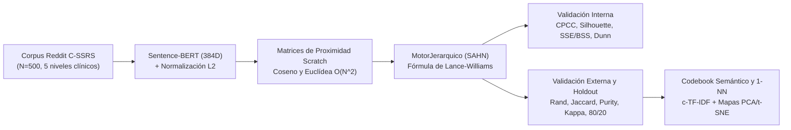

🌐 **Language / Idioma:** [English](README.md) • [Español](README.es.md)

# clinical-text-clustering: Minería de Datos y Clustering No Supervisado de Texto Clínico

[](https://www.python.org/)
[](https://www.sbert.net/)
[](https://numpy.org/)
[](https://www.ehu.eus/)

> **Proyecto de Minería de Datos / Aprendizaje No Supervisado (UPV/EHU)**  
> Implementación desde cero (*Scratch*) de clustering jerárquico aglomerativo SAHN mediante la fórmula recursiva de **Lance-Williams (1967)**, embeddings densos contextuales (**Sentence-BERT**), validación interna/externa multidimensional y perfilado semántico sobre historiales clínicos de Reddit (**Corpus C-SSRS**, $N = 500$ usuarios).

---

## 📋 Tabla de Contenidos
1. [Descripción General](#-descripción-general)
2. [Arquitectura del Pipeline](#-arquitectura-del-pipeline)
3. [Estructura del Proyecto](#-estructura-del-proyecto)
4. [Fundamentos Teóricos](#-fundamentos-teóricos)
5. [Distribución de Responsabilidades](#-distribución-de-responsabilidades)
6. [Catálogo de Gráficas Generadas](#-catálogo-de-gráficas-generadas)
7. [Instalación y Requisitos](#-instalación-y-requisitos)
8. [Guía de Ejecución](#-guía-de-ejecución)
9. [Ejemplo Didáctico (Toy-Example)](#-ejemplo-didáctico-toy-example)
10. [Referencias Bibliográficas](#-referencias-bibliográficas)

---

## 🔬 Descripción General

El objetivo de este proyecto es analizar, agrupar y caracterizar semánticamente publicaciones clínicas de usuarios de Reddit procedentes del corpus **Zenodo C-SSRS** (Gaur et al., 2019), implementando desde cero los algoritmos centrales de agrupamiento y validación:

* **Representación vectorial:** Embeddings densos contextuales de $384$ dimensiones mediante Sentence-BERT (`all-MiniLM-L6-v2`) con normalización L2 opcional.
* **Espacios métricos Scratch:** Cálculo vectorizado en NumPy de matrices de proximidad (Distancia Coseno y Euclídea) y análisis empírico de pérdida de contraste en alta dimensionalidad (Aggarwal et al., 2001).
* **Clustering Jerárquico Aglomerativo (SAHN) Scratch:** Motor completo con la fórmula recursiva de **Lance-Williams (1967)** para enlace simple (*Single*), completo (*Complete*) y promedio (*Average / UPGMA*).
* **Validación Interna:** Coeficiente de Correlación Cofenética (`CPCC`), Silhouette Score y perfil muestra a muestra, compromiso Cohesión/Separabilidad (`SSE`/`BSS`), índice de Dunn y selección no supervisada de $K$.
* **Validación Externa y Holdout:** Rand, Jaccard, Fowlkes-Mallows, Pureza (*Clustering Accuracy*), Kappa de Cohen, Macro-F1, partición Holdout $80\%$ Train / $20\%$ Test sin fuga de etiquetas, Codebook semántico ($6\times3$ trigramas c-TF-IDF) e inferencia interactiva `1-NN` intra-cluster.

---

## 🏗️ Arquitectura del Pipeline



---

## 📁 Estructura del Proyecto

```text
clinical-text-clustering/
│
├── data/                                 # Datos crudos (excluidos de Git por NDA)
│   ├── .gitkeep
│   └── 500_Reddit_users_posts_labels.csv # Dataset clínico anotado (colocar aquí)
│
├── data_processed/                       # Artefactos y figuras generadas (excluidos de Git)
│   ├── .gitkeep
│   ├── embeddings_sbert.npy              # Matriz de embeddings densos (500 x 384)
│   ├── etiquetas_reales.npy              # Clases de riesgo reales [0..4]
│   ├── matriz_distancias_cosine.npy      # Matriz NxN de distancias Coseno
│   ├── matriz_distancias_euclidean.npy   # Matriz NxN de distancias Euclídeas
│   ├── textos_posts.json                 # Textos normalizados de cada usuario
│   ├── comparativa_distancias.png        # Gráfica de contraste Coseno vs Euclídeo
│   ├── metricas_espacios_y_profiling.json# Métricas y profiling O(N^2)
│   └── graficas_informe/                 # Figuras científicas generadas
│
├── src/                                  # Código fuente modular
│   ├── __init__.py
│   ├── config.py                         # Configuración centralizada de rutas y constantes
│   ├── embeddings.py                     # SBERT, distancias scratch y profiling O(N^2)
│   ├── metricas_internas.py              # CPCC, Silueta, SSE/BSS, Dunn y dendrograma
│   ├── evaluacion.py                     # Validación externa, Holdout, Codebook e inferencia
│   ├── experimentos.py                   # Experimentos de dimensión, normalización y K-Means
│   └── clustering/                       # Motor aglomerativo Scratch
│       ├── __init__.py
│       ├── hierarchical.py               # MotorJerarquico (SAHN iterativo)
│       └── lance_williams.py             # Parámetros y actualización de Lance-Williams
│
├── main.py                               # Orquestador principal CLI unificado
├── pipeline.py                           # Carga y preprocesado del corpus
├── toy_example.py                        # Demostración paso a paso (toy-example)
├── ejecutar_pipeline.ps1                 # Script de ejecución para Windows PowerShell
├── ejecutar_pipeline.bat                 # Script de ejecución para Windows CMD
├── ejecutar_pipeline.sh                  # Script de ejecución para Linux/macOS Bash
├── requirements.txt                      # Dependencias del entorno Python
├── .gitignore                            # Exclusión de datos confidenciales y binarios
├── README.md                             # Documentación en inglés
└── README.es.md                          # Documentación en español
```

---

## 🧠 Fundamentos Teóricos

1. **Ontología Clínica C-SSRS (Gaur et al., 2019):** 5 niveles clínicos (`Indicator`, `Ideation`, `Behavior`, `Attempt`, `Supportive`) utilizados únicamente en la fase de evaluación externa posterior al agrupamiento.
2. **Representaciones Contextuales SBERT (Reimers & Gurevych, 2019):** `all-MiniLM-L6-v2` proyecta los textos en $\mathbb{R}^{384}$ en tiempo lineal $\mathcal{O}(N)$.
3. **Contraste Métrico en Alta Dimensión (Aggarwal et al., 2001):** En $D \ge 384$, la distancia euclídea sufre concentración de distancias ($\frac{d_{\max} - d_{\min}}{d_{\min}} \to 0$), mientras que la distancia del coseno mantiene mejor contraste relativo e invarianza a la longitud.
4. **Fórmula Recursiva de Lance & Williams (1967):** Recalcula la distancia entre un cluster fusionado $C_i \cup C_j$ y cualquier cluster $C_k$ en tiempo $\mathcal{O}(1)$:
   $$d(C_i \cup C_j, C_k) = \alpha_i d(C_i, C_k) + \alpha_j d(C_j, C_k) + \beta d(C_i, C_j) + \gamma |d(C_i, C_k) - d(C_j, C_k)|$$
5. **Coeficiente de Correlación Cofenética (CPCC, Sokal & Rohlf, 1962):** Correlación lineal de Pearson entre las distancias originales $D_{ij}$ y las distancias cofenéticas $C_{ij}$ del dendrograma.

---

## 👥 Distribución de Responsabilidades

| Miembro del Equipo | Módulos Asignados | Responsabilidad Técnica Principal |
|---|---|---|
| **Aimar Larriba** | `main.py`, `src/embeddings.py`, `src/experimentos.py`, `src/config.py` | Orquestación CLI, inferencia `--infer`, embeddings SBERT L2, matrices scratch Coseno/Euclídea, análisis de contraste de Aggarwal, profiling $\mathcal{O}(N^2)$, experimentos de dimensión/normalización y baseline K-Means. |
| **Adrián Ramírez** | `src/metricas_internas.py`, `src/clustering/lance_williams.py` | Fórmulas recursivas de Lance-Williams (`single`, `complete`, `average`), métricas intrínsecas Scratch (CPCC, SSE/BSS, Silueta, Dunn) y búsqueda no supervisada de $K$. |
| **Urko Horas** | `src/clustering/hierarchical.py`, `src/clustering/__init__.py`, `toy_example.py` | Motor aglomerativo SAHN iterativo Scratch, matriz de enlace formato SciPy, corte del dendrograma y ejemplo didáctico autocontenido. |
| **María Fernández** | `src/evaluacion.py`, `pipeline.py` | Validación externa frente a C-SSRS, protocolo Holdout $80/20$ sin fuga de etiquetas, matriz de confusión dual Train-Test, Codebook $6\times3$ (c-TF-IDF) e inferencia `1-NN` intra-cluster. |

---

## 📊 Catálogo de Gráficas Generadas

Las figuras se exportan automáticamente en `data_processed/graficas_informe/`:
* `fig1_cpcc_distorsion_lance_williams.png` — Comparativa CPCC y distorsión jerárquica (`Single`, `Complete`, `Average`).
* `fig2_curva_silhouette_picos.png` — Evolución de la silueta media en $k \in [2, \sqrt{N}]$.
* `fig3_compromiso_sse_bss.png` — Compromiso entre Cohesión ($SSE$) y Separabilidad ($BSS$).
* `fig4_perfil_silueta_k5_vs_k15.png` — Perfil detallado de silueta ($K=5$ vs. $\hat{k}=15$).
* `fig5_dendrograma_jerarquico_corte.png` — Dendrograma completo y detalle en la altura exacta de corte.
* `fig6_mapa_pca_centroides.png` / `fig6a` / `fig6b` / `fig11` — Proyecciones PCA y t-SNE de clusters.
* `fig7_tabla_codebook_6x3_ventanas.png` — Codebook semántico ($6\times3$ trigramas c-TF-IDF y prototipos).
* `fig8_correlacion_externa_k.png` — Curvas de validación externa en función de $K$.
* `fig9_evidencias_dimension_y_normalizacion.png` — Curva de calidad vs. dimensión ($D \in [2..384]$), TF-IDF vs. SBERT y efecto de normalización.
* `fig10_matriz_confusion_heatmap.png` — Matriz de confusión dual Train ($N_1=400$) vs. Test ($N_2=100$).
* `comparativa_distancias.png` — Histograma de contraste relativo Coseno vs. Euclídea.

---

## 💻 Instalación y Requisitos

1. Clonar el repositorio y colocar `500_Reddit_users_posts_labels.csv` en `data/`:
   ```bash
   git clone https://github.com/aimarlarriba/clinical-text-clustering.git
   cd clinical-text-clustering
   ```

2. Crear y activar un entorno virtual:
   * **Windows (PowerShell):**
     ```powershell
     python -m venv .venv
     .\.venv\Scripts\Activate.ps1
     ```
   * **Linux / macOS:**
     ```bash
     python3 -m venv .venv
     source .venv/bin/activate
     ```

3. Instalar las dependencias:
   ```bash
   pip install -r requirements.txt
   ```

---

## 🚀 Guía de Ejecución

```bash
# Flujo completo
python main.py

# Lanzadores por sistema operativo
.\ejecutar_pipeline.ps1   # Windows PowerShell
ejecutar_pipeline.bat     # Windows CMD
./ejecutar_pipeline.sh    # Linux / macOS

# Ejecución modular por fases
python main.py --step embeddings --n_muestras 500
python main.py --step evaluacion
python main.py --step experimentos
python main.py --infer "I feel completely exhausted and want to give up everything"
python main.py --n_muestras 200
```

---

## 🧪 Ejemplo Didáctico (Toy-Example)

Script autocontenido que ejecuta paso a paso las rutinas *Scratch* sobre datos sintéticos y un mini-corpus textual en menos de 1 segundo:
```bash
python toy_example.py
# o mediante:
python main.py --toy
```

---

## 📚 Referencias Bibliográficas

* **Gaur, M., Alambo, A., Sain, J. P., et al. (2019).** *Knowledge-aware assessment of severity of suicide risk for early intervention.* WWW '19, pp. 514–525.
* **Lance, G. N., & Williams, W. T. (1967).** *A general theory of classificatory sorting strategies: 1. Hierarchical systems.* The Computer Journal, 9(4), 373–380.
* **Reimers, N., & Gurevych, I. (2019).** *Sentence-BERT: Sentence Embeddings using Siamese BERT-Networks.* EMNLP '19.
* **Sokal, R. R., & Rohlf, F. J. (1962).** *The comparison of dendrograms by objective methods.* Taxon, 11(2), 33–40.
* **Aggarwal, C. C., Hinneburg, A., & Keim, D. A. (2001).** *On the surprising behavior of distance metrics in high dimensional space.* ICDT '01, pp. 420–434.
