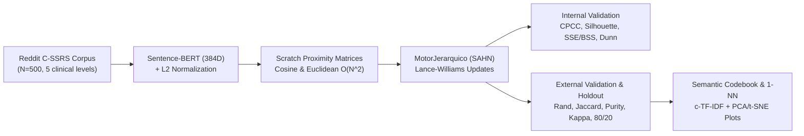

🌐 **Language / Idioma:** [English](README.md) • [Español](README.es.md)

# text-clustering-MD: Unsupervised Clinical Text Clustering (Reddit C-SSRS)

[](https://www.python.org/)
[](https://www.sbert.net/)
[](https://numpy.org/)
[](https://www.ehu.eus/)

> **Data Mining / Unsupervised Learning Project (UPV/EHU)**  
> From-scratch implementation of Sequential Agglomerative Hierarchical Non-overlapping (SAHN) clustering via **Lance-Williams (1967)** recursive updates, contextual dense embeddings (**Sentence-BERT**), internal/external multidimensional validation, and semantic topic profiling on clinical Reddit timelines (**C-SSRS Corpus**, $N = 500$ users).

---

## 📋 Table of Contents
1. [Overview](#-overview)
2. [Pipeline Architecture](#-pipeline-architecture)
3. [Project Structure](#-project-structure)
4. [Theoretical Foundations](#-theoretical-foundations)
5. [Team Package Responsibilities](#-team-package-responsibilities)
6. [Generated Figures Catalog](#-generated-figures-catalog)
7. [Installation & Requirements](#-installation--requirements)
8. [Quickstart CLI Guide](#-quickstart-cli-guide)
9. [Toy Example](#-toy-example)
10. [References](#-references)

---

## 🔬 Overview

This project analyzes, groups, and semantically characterizes clinical social media posts from the **Zenodo C-SSRS** corpus (Gaur et al., 2019), implementing core unsupervised algorithms from scratch without high-level clustering wrappers:

* **Vector Representation:** Dense contextual embeddings in $\mathbb{R}^{384}$ via Sentence-BERT (`all-MiniLM-L6-v2`) with optional L2 normalization.
* **Scratch Metric Spaces:** Vectorized NumPy computation of Cosine and Euclidean proximity matrices and empirical evaluation of distance concentration in high dimensions (Aggarwal et al., 2001).
* **From-Scratch Hierarchical Clustering (SAHN):** Complete agglomerative engine implementing **Lance-Williams (1967)** recursive matrix updates (`single`, `complete`, `average` / UPGMA) producing canonical SciPy-compatible linkage matrices.
* **Internal Validation:** Cophenetic Correlation Coefficient (`CPCC`), Silhouette Score & per-sample silhouette profile, Cohesion/Separation (`SSE`/`BSS`), Dunn Index, and unsupervised $K$ selection.
* **External Validation & Clinical Alignment:** Rand, Jaccard, Fowlkes-Mallows, Purity (class-to-cluster accuracy), Cohen's Kappa, Macro-F1, and confusion matrices against the 5 C-SSRS risk levels.
* **Leakage-Free Holdout & 1-NN Inference:** $80\%$ Train / $20\%$ Test split, centroid/1-NN assignment on unseen instances, semantic Codebook ($6\times3$ c-TF-IDF windows + prototype sentences), and interactive `--infer` retrieval.

---

## 🏗️ Pipeline Architecture



---

## 📁 Project Structure

```text
text-clustering-MD/
│
├── data/                                 # Raw data (excluded from Git under NDA)
│   ├── .gitkeep
│   └── 500_Reddit_users_posts_labels.csv # Annotated clinical dataset (place here)
│
├── data_processed/                       # Serialized caches & outputs (excluded from Git)
│   ├── .gitkeep
│   ├── embeddings_sbert.npy              # Dense SBERT embeddings (500 x 384)
│   ├── etiquetas_reales.npy              # Ground-truth C-SSRS labels
│   ├── matriz_distancias_*.npy           # Cosine & Euclidean distance matrices
│   ├── textos_posts.json                 # Cleaned user texts
│   ├── metricas_espacios_y_profiling.json# Space contrast & O(N^2) profiling
│   └── graficas_informe/                 # Publication-ready figures
│
├── src/                                  # Modular source code
│   ├── __init__.py
│   ├── config.py                         # Centralized paths, hyperparameters & C-SSRS map
│   ├── embeddings.py                     # SBERT, scratch distances & O(N^2) profiling
│   ├── metricas_internas.py              # CPCC, Silhouette, SSE/BSS, Dunn & dendrogram cut
│   ├── evaluacion.py                     # External metrics, Holdout, Codebook & 1-NN inference
│   ├── experimentos.py                   # Dimensionality, normalization & K-Means baselines
│   └── clustering/                       # From-scratch agglomerative engine
│       ├── __init__.py
│       ├── hierarchical.py               # MotorJerarquico (iterative SAHN)
│       └── lance_williams.py             # Lance-Williams coefficients & matrix update
│
├── main.py                               # Unified CLI orchestrator
├── pipeline.py                           # Data loading & preprocessing pipeline
├── toy_example.py                        # Step-by-step synthetic & text demonstration
├── ejecutar_pipeline.ps1                 # Windows PowerShell launcher
├── ejecutar_pipeline.bat                 # Windows CMD launcher
├── ejecutar_pipeline.sh                  # Linux / macOS Bash launcher
├── requirements.txt                      # Python dependencies
├── .gitignore                            # Confidentiality & binary exclusions
├── README.md                             # English documentation
└── README.es.md                          # Spanish documentation
```

---

## 🧠 Theoretical Foundations

1. **C-SSRS Clinical Ontology (Gaur et al., 2019):** 5 clinical categories (`Indicator`, `Ideation`, `Behavior`, `Attempt`, `Supportive`) used exclusively in external post-hoc validation.
2. **Dense Contextual Embeddings (Reimers & Gurevych, 2019):** `all-MiniLM-L6-v2` projects user posts into $\mathbb{R}^{384}$ in linear time $\mathcal{O}(N)$.
3. **High-Dimensional Metric Contrast (Aggarwal et al., 2001):** In $D \ge 384$, Euclidean relative contrast $(d_{\max} - d_{\min}) / d_{\min}$ concentrates toward zero, whereas Cosine distance preserves better separability and length invariance.
4. **Lance-Williams Recursive Formula (1967):** Updates cluster distances in $\mathcal{O}(1)$ per pair after merging $C_i \cup C_j$:
   $$d(C_i \cup C_j, C_k) = \alpha_i d(C_i, C_k) + \alpha_j d(C_j, C_k) + \beta d(C_i, C_j) + \gamma |d(C_i, C_k) - d(C_j, C_k)|$$
5. **Cophenetic Correlation (CPCC, Sokal & Rohlf, 1962):** Pearson correlation between original pairwise distances $D_{ij}$ and dendrogram cophenetic distances $C_{ij}$.

---

## 👥 Team Package Responsibilities

| Team Member | Assigned Modules | Primary Technical Scope |
|---|---|---|
| **Aimar Larriba** | `main.py`, `src/embeddings.py`, `src/experimentos.py`, `src/config.py` | CLI orchestration, `--infer`, SBERT L2 embeddings, vectorized scratch distance matrices, Aggarwal contrast analysis, $\mathcal{O}(N^2)$ profiling, dimensionality/normalization experiments & K-Means baseline. |
| **Adrián Ramírez** | `src/metricas_internas.py`, `src/clustering/lance_williams.py` | Lance-Williams updates (`single`, `complete`, `average`), scratch intrinsic metrics (CPCC, SSE/BSS, Silhouette, Dunn), and unsupervised $K$ peak selection. |
| **Urko Horas** | `src/clustering/hierarchical.py`, `src/clustering/__init__.py`, `toy_example.py` | Iterative SAHN engine, SciPy-compatible linkage matrix, dendrogram cutting, and self-contained toy example. |
| **María Fernández** | `src/evaluacion.py`, `pipeline.py` | External validation against C-SSRS, leakage-free $80/20$ Holdout, dual Train-Test confusion matrix, $6\times3$ c-TF-IDF Codebook, and 1-NN intra-cluster retrieval. |

---

## 📊 Generated Figures Catalog

Figures are exported to `data_processed/graficas_informe/`:
* `fig1_cpcc_distorsion_lance_williams.png` — CPCC & hierarchical distortion (`Single`, `Complete`, `Average`).
* `fig2_curva_silhouette_picos.png` — Mean Silhouette curve across $k \in [2, \sqrt{N}]$.
* `fig3_compromiso_sse_bss.png` — Cohesion ($SSE$) vs. Separation ($BSS$) trade-off.
* `fig4_perfil_silueta_k5_vs_k15.png` — Per-sample Silhouette profile ($K=5$ vs. $\hat{k}=15$).
* `fig5_dendrograma_jerarquico_corte.png` — Full & truncated dendrogram at exact cut height.
* `fig6_mapa_pca_centroides.png` / `fig6a` / `fig6b` / `fig11` — PCA and t-SNE cluster projections.
* `fig7_tabla_codebook_6x3_ventanas.png` — Semantic Codebook ($6\times3$ c-TF-IDF trigrams + prototypes).
* `fig8_correlacion_externa_k.png` — External metrics vs. $K$.
* `fig9_evidencias_dimension_y_normalizacion.png` — Dimension sweep ($D \in [2..384]$), TF-IDF vs. SBERT, and normalization.
* `fig10_matriz_confusion_heatmap.png` — Dual Train ($N_1=400$) vs. Test ($N_2=100$) confusion matrix.
* `comparativa_distancias.png` — Cosine vs. Euclidean contrast histogram.

---

## 💻 Installation & Requirements

1. Clone the repository and place `500_Reddit_users_posts_labels.csv` in `data/`:
   ```bash
   git clone https://github.com/aimarlarriba/text-clustering-MD.git
   cd text-clustering-MD
   ```

2. Create and activate a virtual environment:
   * **Windows (PowerShell):**
     ```powershell
     python -m venv .venv
     .\.venv\Scripts\Activate.ps1
     ```
   * **Linux / macOS:**
     ```bash
     python3 -m venv .venv
     source .venv/bin/activate
     ```

3. Install dependencies:
   ```bash
   pip install -r requirements.txt
   ```

---

## 🚀 Quickstart CLI Guide

```bash
# Full pipeline
python main.py

# OS launchers
.\ejecutar_pipeline.ps1   # Windows PowerShell
ejecutar_pipeline.bat     # Windows CMD
./ejecutar_pipeline.sh    # Linux / macOS

# Modular execution
python main.py --step embeddings --n_muestras 500
python main.py --step evaluacion
python main.py --step experimentos
python main.py --infer "I feel completely exhausted and want to give up everything"
python main.py --n_muestras 200
```

---

## 🧪 Toy Example

Self-contained verification of all from-scratch routines (Lance-Williams $3\times3$, `MotorJerarquico`, CPCC/Silhouette/Dunn, external metrics, 1-NN, and mini text corpus):
```bash
python toy_example.py
# or:
python main.py --toy
```

---

## 📚 References

* **Gaur, M., Alambo, A., Sain, J. P., Kursuncu, U., et al. (2019).** *Knowledge-aware assessment of severity of suicide risk for early intervention.* WWW '19, pp. 514–525.
* **Lance, G. N., & Williams, W. T. (1967).** *A general theory of classificatory sorting strategies: 1. Hierarchical systems.* The Computer Journal, 9(4), 373–380.
* **Reimers, N., & Gurevych, I. (2019).** *Sentence-BERT: Sentence Embeddings using Siamese BERT-Networks.* EMNLP '19.
* **Sokal, R. R., & Rohlf, F. J. (1962).** *The comparison of dendrograms by objective methods.* Taxon, 11(2), 33–40.
* **Aggarwal, C. C., Hinneburg, A., & Keim, D. A. (2001).** *On the surprising behavior of distance metrics in high dimensional space.* ICDT '01, pp. 420–434.
